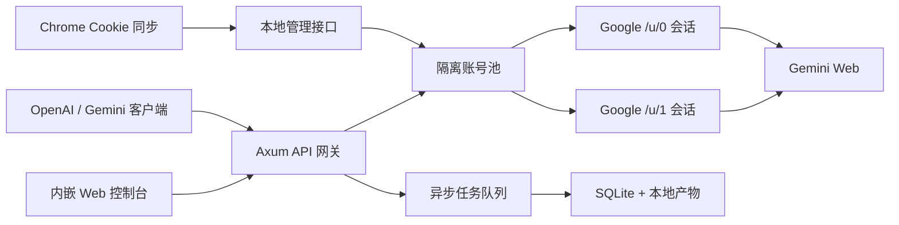

# Gemini Rust Gateway

[](https://github.com/chuanxu742-glitch/gemini-rust-gateway/actions/workflows/ci.yml)
[](https://github.com/chuanxu742-glitch/gemini-rust-gateway/releases)
[](https://www.rust-lang.org/)
[](LICENSE)

一个纯 Rust 的 Gemini Web API 网关。它把 Gemini Web 会话转换为 OpenAI Chat、OpenAI Responses 和 Gemini `generateContent` 风格接口，同时提供多账号轮换、图片生成、异步任务、内嵌控制台和 Chrome Cookie 同步。

不需要 Python、Node.js 或外部数据库运行服务；下载对应平台的发布包即可启动。

> [!IMPORTANT]
> 本项目不是 Google 官方 SDK，依赖 Gemini Web 的非公开协议。网页协议变化可能导致接口暂时不可用。请仅在你有权使用的账号和环境中运行，并遵守 Google 的服务条款。

## 功能概览

| 能力 | 状态 | 接口 |
| --- | --- | --- |
| OpenAI Chat Completions | ✅ 普通与 SSE 流式响应 | `POST /v1/chat/completions` |
| OpenAI Responses API | ✅ Codex/新版客户端兼容格式 | `POST /v1/responses` |
| Gemini API | ✅ `generateContent` 与 SSE 流式响应 | `POST /v1beta/models/...` |
| Function/Tool Calling | ✅ OpenAI 与 Gemini 格式转换 | Chat、Responses、Gemini API |
| 图片生成 | ✅ 同步接口与异步任务 | `/v1/images/generations`、`/v1/generations` |
| 其他生成任务 | ✅ 视频、音频、音乐、深度研究、Canvas | `POST /v1/generations` |
| 多账号 | ✅ 隔离、权重、冷却、故障转移、固定账号 | `/v1/accounts`、`X-Gemini-Account` |
| 本地管理界面 | ✅ 编译进二进制，无前端运行时依赖 | `GET /` |
| Cookie 同步 | ✅ Chrome 手动/定时同步多个 Google 账号 | `chrome-extension/` |
| 任务持久化 | ✅ SQLite WAL、迁移、分页和保留期清理 | `gateway_data/tasks.sqlite3` |
| 可观测性 | ✅ 健康检查、就绪检查和 Prometheus 指标 | `/healthz`、`/readyz`、`/metrics` |

## 工作方式



每个 Google 账号拥有独立的 Cookie Jar、HTTP Client、会话元数据、并发限制和健康状态。默认路由会综合在途请求数、账号权重和冷却状态；也可以通过 `X-Gemini-Account` 固定账号。

## 快速开始

### Windows 发布包

从 [GitHub Releases](https://github.com/chuanxu742-glitch/gemini-rust-gateway/releases) 下载 `gemini-rust-gateway-windows-x86_64.zip`，完整解压后运行：

```powershell
.\start.ps1
```

首次运行会生成本地 API Key 和独立管理令牌，创建 `.env` 与 `.env.auth.local`，并可选隐藏输入 Gemini Cookie。后续直接启动，不再重复填写配置。

也可以分步执行：

```powershell
.\gemini-rust-gateway.exe init
.\gemini-rust-gateway.exe doctor --online
.\gemini-rust-gateway.exe serve
```

默认控制台地址为 [http://127.0.0.1:8000](http://127.0.0.1:8000)。

> Windows 发布包中的 EXE 需要同目录内的三个 UCRT DLL。请完整解压 ZIP，不要只复制 EXE。

### Linux 发布包

```bash
tar -xzf gemini-rust-gateway-linux-x86_64.tar.gz
cd gemini-rust-gateway-linux-x86_64
./gemini-rust-gateway init
./gemini-rust-gateway doctor --online
./gemini-rust-gateway serve
```

发布工作流提供 Linux x86_64、Linux ARM64 和 Windows x86_64 包，并生成 SHA-256、SPDX SBOM 与构建证明。

### Docker Compose

```bash
cp .env.example .env
cp .env.auth.example .env.auth.local
docker compose up -d --build
```

启动前请在 `.env` 更换 API Key 和管理令牌。然后选择一种登录方式：在 `.env.auth.local` 填入自己的 Cookie；或者设置 `GEMINI_COOKIE_SYNC_ENABLED=true`，等容器启动后使用 Chrome 扩展同步。

Compose 默认只映射到宿主机 `127.0.0.1:8000`，数据保存在 `gateway-data` volume。生产环境建议使用 Secret Manager 注入凭据，并在前方配置 HTTPS 反向代理。

### 从源码构建

需要 Rust 1.85 或更高版本。

Linux：

```bash
sudo apt-get update
sudo apt-get install -y build-essential cmake ninja-build clang libclang-dev perl golang
cargo run -- init
cargo run --release -- serve
```

Windows 使用项目脚本准备 BoringSSL/MSYS2 UCRT64 工具链：

```powershell
.\scripts\check-build.ps1
.\build.ps1 run -Release init
.\build.ps1 run -Release serve
```

Windows 不建议绕过 `build.ps1` 直接执行 Cargo。脚本负责定位 MSYS2、设置 GCC/CMake/libclang，并在 Release 构建后复制运行库 DLL。

## Cookie 配置与 Chrome 扩展

网关需要 Gemini Web 登录会话，不使用 Google AI Studio API Key。推荐使用仓库自带的 [`chrome-extension`](chrome-extension/README.md) 完成首次同步：

1. 启动网关，确认 `.env` 中 `GEMINI_COOKIE_SYNC_ENABLED=true`；
2. Chrome 打开 `chrome://extensions` 并启用开发者模式；
3. 选择“加载已解压的扩展程序”，指向 `chrome-extension`；
4. 浏览器登录 `https://gemini.google.com/u/0/app`；
5. 在扩展中填写 `GEMINI_ADMIN_TOKEN`、账号名称、`/u/N` 序号和权重；
6. 点击同步，也可以启用每 30 分钟自动同步。

扩展不是服务运行时依赖。它只负责首次注入浏览器登录态、会话彻底失效后的重新授权，以及网关长期空闲时定时同步最新 Cookie。

正常请求过程中，网关会吸收 Google 通过 `Set-Cookie` 轮换的新 `__Secure-1PSIDTS` 并持久化，因此 Docker 和无浏览器部署也能自行续期。

扩展只允许连接 `127.0.0.1` 或 `localhost`。管理接口默认也只接受本机来源；确有反向代理或容器需求时才应设置 `GEMINI_REMOTE_ADMIN_ENABLED=true`。

### 凭据存储

- Windows：账号文件中的 Cookie 使用当前 Windows 用户绑定的 DPAPI 加密；
- Linux/macOS：账号文件权限限制为 `0600`；
- Cookie 不进入任务记录、普通 API 响应或日志；
- `.env`、`.env.auth.local`、账号文件和数据目录均已被 Git 忽略。

## API 调用

除健康检查和内嵌静态页面外，API 请求需要本地令牌：

```text
Authorization: Bearer <GEMINI_API_KEY>
```

Gemini 风格客户端也可以使用 `x-goog-api-key: <GEMINI_API_KEY>`。

### Chat Completions

```bash
curl http://127.0.0.1:8000/v1/chat/completions \
  -H "Authorization: Bearer change-me-local-key" \
  -H "Content-Type: application/json" \
  -d '{"model":"gemini-3-flash","messages":[{"role":"user","content":"你好"}]}'
```

添加 `"stream": true` 即可获得 SSE 流式响应。

### Responses API

```bash
curl http://127.0.0.1:8000/v1/responses \
  -H "Authorization: Bearer change-me-local-key" \
  -H "Content-Type: application/json" \
  -d '{"model":"gemini-3-flash","input":"用一句话解释 Rust 所有权","stream":false}'
```

OpenAI SDK 的基础地址指向本地网关即可：

```python
from openai import OpenAI

client = OpenAI(
    api_key="change-me-local-key",
    base_url="http://127.0.0.1:8000/v1",
)
response = client.responses.create(model="gemini-3-flash", input="你好")
print(response.output_text)
```

### Gemini generateContent

```bash
curl "http://127.0.0.1:8000/v1beta/models/gemini-3-flash:generateContent" \
  -H "x-goog-api-key: change-me-local-key" \
  -H "Content-Type: application/json" \
  -d '{"contents":[{"role":"user","parts":[{"text":"你好"}]}]}'
```

### 图片与异步任务

```bash
curl http://127.0.0.1:8000/v1/images/generations \
  -H "Authorization: Bearer change-me-local-key" \
  -H "Content-Type: application/json" \
  -d '{"model":"gemini-3-flash","prompt":"A matte red cube on a white background","n":1}'
```

异步任务适合耗时更长的生成类型：

```bash
curl http://127.0.0.1:8000/v1/generations \
  -H "Authorization: Bearer change-me-local-key" \
  -H "Content-Type: application/json" \
  -d '{"type":"image","prompt":"A cinematic orange cat astronaut"}'

curl http://127.0.0.1:8000/v1/tasks/<task_id> \
  -H "Authorization: Bearer change-me-local-key"
```

更多示例见 [`examples/client.rs`](examples/client.rs) 和 [`examples/client.ts`](examples/client.ts)。

## 多账号隔离与轮换

同步每个账号时指定稳定的账号 ID、Google `/u/N` 序号和权重。网关会自动：

- 在健康账号中按“最少在途请求 + 权重轮换”选择账号；
- 对 429、网络错误和上游临时错误执行有界重试与故障转移；
- 让限流账号进入冷却，并通过后台探针自动恢复；
- 将 401/403 账号标记为未就绪，等待重新同步；
- 让异步任务始终绑定入队时选择的账号。

需要固定账号时添加请求头：

```text
X-Gemini-Account: work
```

账号状态可通过 `GET /v1/accounts` 或内嵌控制台查看。管理令牌可以启停账号、修改权重或删除账号。

## 主要配置

配置优先级：进程环境变量 > `.env.auth.local` > `.env` > 内置默认值。

| 变量 | 默认值 | 说明 |
| --- | --- | --- |
| `GEMINI_API_KEY` | 必填 | 普通 API 的本地认证令牌，至少 8 字符 |
| `GEMINI_ADMIN_TOKEN` | 回退到 API Key | Cookie 与账号管理专用令牌 |
| `GEMINI_HOST` / `GEMINI_PORT` | `127.0.0.1` / `8000` | 监听地址与端口 |
| `GEMINI_MODEL` | `gemini-3-flash` | 默认模型名 |
| `GEMINI_ADVANCED_MODEL` | `gemini-3-pro` | 媒体/高级任务模型名 |
| `GEMINI_COOKIE_SYNC_ENABLED` | `false` | 允许网关降级启动并等待扩展同步 |
| `GEMINI_REMOTE_ADMIN_ENABLED` | `false` | 允许非本机来源调用管理接口 |
| `GEMINI_ACCOUNTS_FILE` | `gateway_data/accounts.local.json` | 多账号凭据文件 |
| `GEMINI_MAX_ACCOUNT_CONCURRENCY` | `1` | 每账号最大并发数 |
| `GEMINI_ACCOUNT_COOLDOWN_SECONDS` | `60` | 限流账号冷却时间 |
| `GEMINI_ACCOUNT_PROBE_SECONDS` | `60` | 后台账号恢复检查周期 |
| `GEMINI_TASK_WORKERS` / `GEMINI_MAX_TASK_QUEUE` | `1` / `20` | 任务工作数与队列容量 |
| `GEMINI_TASK_RETENTION_HOURS` | `168` | 已完成任务和产物保留时间 |
| `GEMINI_ENABLED_GENERATIONS` | 六种任务全部启用 | 逗号分隔的生成类型 |
| `GEMINI_PROXY` | 自动读取标准代理变量 | URL、`direct` 或 `none` |
| `GEMINI_CORS_ORIGINS` | 空 | 允许的跨域来源，逗号分隔 |

完整配置和注释见 [`.env.example`](.env.example)。代理支持 `HTTPS_PROXY`、`ALL_PROXY` 和 `NO_PROXY` 等标准环境变量。

## HTTP 端点

| 方法 | 路径 | 说明 |
| --- | --- | --- |
| `GET` | `/` | 内嵌 Web 控制台 |
| `GET` | `/health`、`/healthz`、`/readyz` | 健康与就绪检查 |
| `GET` | `/metrics` | Prometheus 文本指标 |
| `GET` | `/v1/models`、`/v1/capabilities` | 模型与网关能力 |
| `GET` | `/v1/accounts` | 脱敏账号状态 |
| `POST` | `/v1/chat/completions` | OpenAI Chat |
| `POST` | `/v1/responses` | OpenAI Responses |
| `GET`/`POST` | `/v1beta/models...` | Gemini 模型与内容生成 |
| `POST` | `/v1/images/generations` | 同步图片生成 |
| `POST` | `/v1/generations` | 提交异步生成任务 |
| `GET` | `/v1/tasks` | 分页查询任务 |
| `GET`/`DELETE` | `/v1/tasks/{id}` | 查询或取消任务 |
| `GET` | `/files/...` | 读取生成产物 |
| `POST` | `/admin/cookies/sync` | 验证、更新并持久化 Cookie |
| `PATCH`/`DELETE` | `/admin/accounts/{id}` | 修改或删除账号 |

错误统一返回：

```json
{"error":{"message":"...","type":"not_ready"}}
```

`503 not_ready` 表示本地没有可用账号，通常同步 Cookie 后即可恢复；`502 provider_error` 表示 Gemini 上游失败，网关会先按配置重试。

## 测试

Linux/macOS：

```bash
cargo fmt --check
cargo clippy --locked --all-targets -- -D warnings
cargo test --locked
cargo build --release --locked
```

Windows：

```powershell
.\build.ps1 fmt
.\build.ps1 clippy
.\build.ps1 test
.\build.ps1 build -Release
.\build.ps1 run -Release doctor --online
```

网关启动后执行端到端验证：

```powershell
.\scripts\smoke-test.ps1
.\scripts\smoke-test.ps1 -Compatibility
.\scripts\smoke-test.ps1 -Image
```

Linux/macOS 使用 `scripts/smoke-test.sh`，并通过 `GEMINI_TEST_COMPAT=1` 或 `GEMINI_TEST_IMAGE=1` 开启额外测试。

测试覆盖协议 fixture、Chat/Responses、Gemini function calling、图像响应解析、多账号权重与 429 故障转移、SQLite 持久化以及 Windows DPAPI。

## 发布与安全

GitHub Actions 会执行格式检查、严格 Clippy、完整测试、Release 构建、JavaScript/Manifest 检查、RustSec 依赖审计和敏感信息扫描。标签构建还会发布 Windows、Linux x86_64/ARM64、GHCR 多架构镜像、SHA-256、SPDX SBOM 和构建来源证明。

安全注意事项：

- Cookie 等同于 Google 登录凭据，不要放入 Issue、日志、截图或聊天；
- 不要提交 `.env`、`.env.auth.local` 或账号数据文件；
- 对外开放服务前必须更换默认令牌，并配置 HTTPS、访问控制和限流；
- 如果 Cookie 曾经公开，请在 Google 账号安全设置中注销相关会话并重新同步。

安全问题请参阅 [SECURITY.md](SECURITY.md)。贡献指南见 [CONTRIBUTING.md](CONTRIBUTING.md)。

## 项目结构

```text
src/                 Rust 网关、协议、账号池、任务与存储
web/                 编译进二进制的管理控制台
chrome-extension/    Chrome Cookie 同步扩展
scripts/             构建检查与端到端冒烟测试
examples/            Rust 和 TypeScript 调用示例
tests/                协议与兼容性 fixtures
vendor/btls-sys/      Windows 构建需要的最小上游补丁
.github/workflows/    CI、Release 与多架构容器发布
```

## License

[AGPL-3.0-only](LICENSE)。`vendor/btls-sys`、BoringSSL 及其他第三方组件保留各自许可证。
